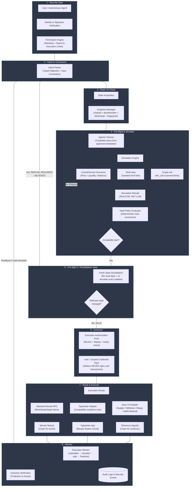

# Mobius — Agentic Transaction Intelligence

**Engineering build document · Architecture revision 2 · 4 November 2026**

Mobius is an agentic transaction-intelligence and execution-orchestration layer for leveraged DeFi positions. It receives a user or agent objective, obtains a versioned chain-state snapshot, creates typed candidate plans, simulates each candidate deterministically, evaluates results against hard policies, and revalidates the selected plan against fresh state immediately before execution.

This is a **one-day prototype playbook**, not a production launch plan. It is built for a three-person team, each working with a coding agent.

---

## What Mobius Is

Mobius is **not** just an `eth_call` wrapper, not a portfolio dashboard, and not an AI chatbot that executes trades. It is a decision-support engine where:

- **The AI agent** interprets intent, proposes typed candidate strategies, and explains trade-offs.
- **Deterministic code and the EVM simulation engine** decide whether a simulation passed, calculate trusted protocol state, and enforce financial safety.
- **The wallet** signs and submits. The backend never signs user transactions.

---

## Core Philosophy

| Responsibility | Who handles it |
|---|---|
| Interpreting user objective | AI agent (planner/explainer only) |
| Calculating Health Factor, liquidation distance, carry | Deterministic risk engine |
| Finding feasible repair actions | Optimization engine (mathematical, not LLM) |
| Explaining trade-offs and recommending actions | AI layer (supporting role) |
| Verifying recommendations against protocol constraints | Deterministic verification layer |
| Signing and broadcasting | User wallet |

**AI never invents Health Factors, guesses oracle prices, or independently decides whether a position is safe.** If a deterministic optimizer can find the best repair, AI is not needed for that part.

---

## Full System Architecture & Execution Flow



### The 8 Architectural Stages in Detail

1. **Stage 1 — Security Gate:** Authenticates the calling user or autonomous agent. Enforces deterministic permission policies: allowlisted chains, allowed action families, per-action and per-session spend limits.

2. **Stage 2 — Intent & Constraints:** Converts natural-language or structured agent requests into typed objectives (`minAmountOut`, `maxSlippageBps`, `maxInputAmount`, `maxGasWei`, `minHealthFactor`). Hard constraints can never be relaxed by an LLM.

3. **Stage 3 — Read On-Chain (State Acquisition):** Snapshot Manager pins `chainId`, `blockNumber`, `blockHash`, timestamp, and computes a cryptographically verifiable **dependency fingerprint** (`rateWad`, oracle answer, reserve liquidity, user balance, allowance).

4. **Stage 4 — Pre-flight & Simulate:**
   - **Agentic Planner:** Generates typed candidate strategies from approved templates (e.g. `candidate_swap` vs `candidate_hold`, `repay_debt`, `add_collateral`).
   - **Simulation Engine:** Single-call `eth_call` at pinned block; multi-step via isolated Anvil fork; counterfactual stress scenarios.
   - **Hard Policy Evaluator:** Filters out any candidate violating hard constraints.

5. **Stage 5 — Pre-flight 2 / Revalidation Gate:** Re-reads critical dependencies and re-computes the state fingerprint immediately before signature. Returns `REPLAN_REQUIRED` or `BLOCKED` on drift. Never silently lowers `minOut`.

6. **Stage 6 — Authorize:** Prepares an explicit execution authorization view for human review. Wallet signs. **Mobius backend NEVER holds custody or signs user transactions.**

7. **Stage 7 — Route & Execute:** Aave V3 (Sepolia), Typewriter (Monad Testnet), Standard RPC (Monad Testnet).

8. **Stage 8 — Monitor:** Tracks settlement lifecycle `submitted → included → safe → finalized`. Compares predicted vs actual state deltas.

---

## API Endpoints

| Endpoint | Method | Purpose |
|---|---|---|
| `GET /health` | GET | Process health and configured chain IDs |
| `GET /v1/chains` | GET | Supported chains and RPC availability |
| `POST /v1/preflight` | POST | Simulate one generic transaction against pinned snapshot |
| `POST /v1/agentic/plan` | POST | Typed objective → candidate plans → simulation → recommendation |
| `POST /v1/agentic/plan/natural` | POST | Natural language → LLM parses intent → typed plan (Zod-validated) |
| `POST /v1/agentic/revalidate` | POST | Re-read dependencies, re-simulate, return VALID / REPLAN_REQUIRED / BLOCKED |
| `POST /v1/execution/prepare` | POST | Validated wallet transaction request (backend does NOT sign) |
| `POST /v1/execution/:id/submit` | POST | Wallet reports transaction submission (txHash) |
| `POST /v1/execution/:id/include` | POST | Record onchain inclusion (block number + actual state) |
| `GET /v1/execution/:id` | GET | Execution record with predicted-vs-observed comparison |
| `GET /v1/execution/` | GET | List all executions |
| `GET /v1/aave/sepolia/market` | GET | Resolve Aave Pool and asset metadata |
| `GET /v1/aave/sepolia/positions/:user` | GET | Aave user position summary |
| `POST /v1/aave/sepolia/supply/preflight` | POST | Check balance/allowance, simulate supply if ready |
| `POST /v1/aave/sepolia/withdraw/preflight` | POST | Simulate withdrawal from user position |
| `POST /v1/aave/sepolia/repay/preflight` | POST | Simulate Pool.repay(asset, amount, rateMode, user) |
| `POST /v1/aave/sepolia/add-collateral/preflight` | POST | Simulate Pool.supply + setUserReserveCollateral |

### Candidate Strategies Supported

| Strategy | Protocol | Description |
|---|---|---|
| `execute_swap` | MockSwapTarget | `swap(amountIn, minOut)` with slippage check |
| `hold_defer` | Any | No transaction — safe default |
| `repay_debt` | Aave V3 | `Pool.repay(asset, amount, rateMode, user)` |
| `add_collateral` | Aave V3 | `Pool.supply(asset, amount, user, 0)` + `Pool.setUserReserveCollateral(asset, true)` |

---

## Status Semantics

| Status | Meaning |
|---|---|
| `SIMULATION_PASSED` | Exact call succeeded against the stated snapshot only |
| `SIMULATION_REVERTED` | Exact call reverted against the stated snapshot |
| `PLAN_READY` | At least one candidate satisfies simulation and policy |
| `VALID` | Selected plan survived fresh-state revalidation; presentable for signature |
| `REPLAN_REQUIRED` | Relevant state changed; old plan must not be submitted |
| `BLOCKED` | No candidate allowed under user's hard constraints |
| `submitted` / `included` / `safe` / `finalized` | Execution lifecycle stages |
| `Typewriter accepted` | Typewriter locally ordered/executed mutation; NOT onchain inclusion |

---

## Chain Separation (Critical)

| Purpose | Network | Chain ID | RPC |
|---|---|---|---|
| Mobius demo + Typewriter POC | Monad Testnet | `10143` | `https://testnet-rpc.monad.xyz` |
| Aave V3 protocol test | Ethereum Sepolia | `11155111` | Your Sepolia RPC provider |
| Stateful multi-action simulation | Local Anvil fork | Fork of requested chain | `127.0.0.1` |

**Never** use the Sepolia Aave Pool address on Monad. Never label a Sepolia Aave transaction as a Monad transaction. Store `chainId` alongside every snapshot, plan, action, hash, contract address, and status.

---

## Repository Structure

```
mobius/
├── apps/
│   ├── api/                 # Express backend (Agent A / Lead)
│   │   ├── src/
│   │   │   ├── server.ts
│   │   │   ├── routes/
│   │   │   │   ├── health.ts
│   │   │   │   ├── chains.ts
│   │   │   │   ├── preflight.ts
│   │   │   │   ├── agentic.ts       # plan, plan/natural, revalidate
│   │   │   │   ├── execution.ts     # prepare, submit, include, get, list
│   │   │   │   └── aave.ts          # market, supply, withdraw, repay, add-collateral
│   │   │   └── services/
│   │   │       ├── error-classifier.ts
│   │   │       ├── snapshot-service.ts
│   │   │       └── orchestration-service.ts
│   │   ├── e2e-agentic.test.ts    # End-to-end test suite
│   │   ├── package.json
│   │   └── tsconfig.json
│   └── typewriter-poc/      # Thin Typewriter adapter / isolated runner (Agent C)
├── contracts/
│   ├── foundry.toml
│   ├── src/
│   │   └── MockSwapTarget.sol        # Deterministic demo target (Agent B)
│   ├── test/
│   │   └── MockSwapTarget.t.sol
│   └── script/
│       └── DeployMockSwapTarget.s.sol
├── packages/
│   ├── chain-config/        # Viem chain clients, chain ID assertions (Agent A / Lead)
│   ├── contracts-abi/       # Shared TypeScript interfaces (all)
│   │   ├── src/preflight.ts
│   │   ├── src/agentic.ts
│   │   ├── src/aave.ts
│   │   └── src/mock-swap.ts
│   ├── aave-adapter/        # Aave V3 Sepolia client (Agent C)
│   │   ├── src/aave-client.ts
│   │   ├── src/abis.ts
│   │   ├── src/constants.ts
│   │   ├── src/supply-preflight.ts
│   │   ├── src/withdraw-preflight.ts
│   │   ├── src/repay-preflight.ts
│   │   └── src/addCollateral-preflight.ts
│   ├── simulation/          # Simulation engine (Agent A / Lead)
│   │   ├── src/simulate-call.ts
│   │   ├── src/snapshot-manager.ts
│   │   └── src/fork-runner.ts   # Isolated Anvil fork for multi-step candidates
│   ├── policies/            # Deterministic policy evaluation (Agent A / Lead)
│   │   ├── src/constraints.ts
│   │   └── src/evaluator.ts
│   └── llm-adapter/         # Optional LLM integration (mock + Groq providers)
│       ├── src/types.ts
│       ├── src/mock-provider.ts
│       ├── src/groq-provider.ts
│       ├── src/intent-parser.ts
│       ├── src/candidate-proposer.ts
│       └── src/explainer.ts
├── deployments/
│   ├── monad-testnet.json
│   └── sepolia-aave.json
├── docs/
│   ├── integration-notes.md
│   ├── demo-script.md
│   └── build-report.md
├── scripts/
│   └── test-monad-integration.mjs
├── .env.example
├── .env                     # Local secrets (gitignored)
├── .gitignore
├── PROJECT_MEMORY.md
└── README.md
```

---

## MockSwapTarget (Monad Testnet Demo Contract — Teammate 1 Scope)

A deterministic simulation harness, **not a real DEX**. It does not exchange tokens or custody assets. Its sole purpose is to model a quote-dependent execution condition so Mobius can prove stale-quote detection and revalidation.

### Live Monad Testnet Deployment (Verified)

| Field | Value |
|---|---|
| **Contract Address** | `0xA64c3bA49910baa01515360278AA2542AaAD0219` |
| **Deployer / Owner** | `0x2345ff8Ca8cf8c504F01d26F7064Ef7cb31Dc75D` |
| **Transaction Hash** | `0x465de4362c59dbbb9b4f4e6e489e5d34ab17cfe32bdde8c9f13f6a73a5bcc02e` |
| **Block** | `76872485` |
| **Gas Paid** | 0.036102427000350509 MON |
| **Verification** | Sourcify (verified) |
| **Explorer** | [View on Monadscan](https://testnet.monadscan.com/address/0xA64c3bA49910baa01515360278AA2542AaAD0219) |

### Contract Functions

- `rateWad()`: owner-updatable exchange rate (scaled to 1e18 WAD), initial `1e18`
- `quote(amountIn)`: view function returning `(amountIn * rateWad) / 1e18`
- `swap(amountIn, minOut)`: executes simulated swap, reverts `SlippageExceeded` if output < minOut
- `setRate(newRateWad)`: owner-only rate update (used to simulate TOCTOU drift)
- `totalSimulatedOutput()`: cumulative simulated output

### Stale Quote Demo Flow

1. User reads `quote(100)` = `100` at `rateWad = 1e18`
2. User plans `swap(100, minOut=100)` → Mobius simulates: PASSED
3. Owner calls `setRate(0.8e18)` on Monad Testnet → new quote = `80`
4. Mobius revalidates → `REPLAN_REQUIRED` (output 80 < minOut 100)
5. Mobius does **not** auto-lower minOut or broadcast stale calldata
6. User submits new objective with `minOut=80` → plan succeeds

---

## Aave V3 Sepolia Integration

- Pool resolved dynamically from `PoolAddressesProvider.getPool()`
- Test assets via Aave faucet on Sepolia test market
- **Never** hardcode Pool address; resolve at runtime
- **Never** route Aave calls through Typewriter

### Supported Actions

| Action | Pool Method | Preflight |
|---|---|---|
| `supply` | `Pool.supply(asset, amount, user, 0)` | ✅ `POST /v1/aave/sepolia/supply/preflight` |
| `withdraw` | `Pool.withdraw(asset, amount, user)` | ✅ `POST /v1/aave/sepolia/withdraw/preflight` |
| `repay_debt` | `Pool.repay(asset, amount, rateMode, user)` | ✅ `POST /v1/aave/sepolia/repay/preflight` |
| `add_collateral` | `Pool.supply()` + `Pool.setUserReserveCollateral()` | ✅ `POST /v1/aave/sepolia/add-collateral/preflight` |

---

## LLM Integration (Optional)

Mobius supports an optional LLM layer for intent parsing and explanation. **The LLM never calculates trusted state.**

### Configuration (`.env`)

```env
LLM_ENABLED=true          # Set to "true" to enable LLM features
LLM_PROVIDER=groq         # mock | groq | openai | anthropic
LLM_MODEL=llama-3.1-8b-instant
GROQ_API_KEY=your_key     # Required when LLM_PROVIDER=groq
```

### Providers

| Provider | Setup | Cost |
|---|---|---|
| `mock` (default) | No API key needed | Free |
| `groq` | `GROQ_API_KEY` from console.groq.com | Free tier available |

### LLM Responsibilities (Sandboxed)

- ✅ Parse natural language → typed `AgenticPlanRequest` (Zod-validated)
- ✅ Propose candidate strategies (filtered to allowed deterministic templates)
- ✅ Explain deterministic results in human-readable language
- ❌ Calculate Health Factors, liquidation distance, carry
- ❌ Decide whether a simulation passed or reverted
- ❌ Guess oracle prices or protocol parameters
- ❌ Override hard policy constraints
- ❌ Sign or broadcast transactions

If LLM is disabled or fails, deterministic fallbacks are used automatically.

---

## Team & Workflow

Three-person team, three branches, no overlapping file ownership:

| Owner | Responsibility | Coding Agent | Allowed Files |
|---|---|---|---|
| You — Lead / Developer 1 | Architecture, API, snapshot manager, planner, orchestrator, policy, merges | Agent A | `apps/api/**`, `packages/chain-config/**`, `packages/contracts-abi/**`, `packages/simulation/**`, `packages/policies/**` |
| Teammate 1 | Solidity / Monad | Agent B | `contracts/**`, `deployments/monad-testnet.json` |
| Teammate 2 | DeFi / Typewriter | Agent C | `packages/aave-adapter/**`, `apps/typewriter-poc/**`, `docs/integration-notes.md` |

**Merge rules:** Human owner reads every diff, runs assigned tests, confirms no secrets or `node_modules` committed, confirms chain IDs and addresses are explicit, confirms no invented deployment addresses.

---

## One-Day Definition of Done

| # | Task | Status |
|---|---|---|
| 1 | Deploy MockSwapTarget to Monad Testnet; verify address and code | ✅ Complete |
| 2 | Submit stale tx to `POST /v1/preflight`; Mobius decodes revert and recommends safe step without broadcasting | ✅ Complete |
| 3 | Submit objective to `POST /v1/agentic/plan`; returns ≥2 typed candidates (execute or hold/defer), simulation results, reasoned recommendation | ✅ Complete |
| 4 | Change target onchain state after planning; `POST /v1/agentic/revalidate` detects drift and returns `REPLAN_REQUIRED` or `BLOCKED` | ✅ Complete |
| 5 | Demonstrate one Aave V3 Sepolia supply flow (or verified market reads + real supply simulation) | ✅ Complete |
| 6 | Run official Typewriter token example locally; capture mutation lifecycle | ✅ Complete |
| 7 | Deploy Typewriter to Monad Testnet only if core path is complete | Stretch goal |
| 8 | Chain ID, block snapshot, status semantics, and execution route explicit in every response | ✅ Complete |

---

## Test Suite

**44 tests passing** across 9 test files:

| Test File | Tests | What's Covered |
|---|---|---|
| `error-classifier.test.ts` | 7 | SlippageExceeded, InvalidAmount, OnlyOwner, UNKNOWN_REVERT classification |
| `evaluator.test.ts` | 7 | Hard constraint evaluation, minAmountOut, maxGasWei, policy blocking |
| `orchestration.test.ts` | 5 | Planning pipeline, HOLD fallback, minAmountOut violation, snapshot recording |
| `llm-adapter.test.ts` | 7 | MockLLMProvider intent parsing, strategy proposal, explanation |
| `groq-provider.test.ts` | 4 | Groq provider safe fallback when no API key |
| `chains.test.ts` | 2 | Chain ID resolution (10143 / 11155111), error handling |
| `health.test.ts` | 2 | Health endpoint, status response |
| `aave.test.ts` | 4 | Supply/withdraw validation, invalid address/amount rejection |
| `e2e-agentic.test.ts` | 5 | Full end-to-end: natural language plan → simulation → revalidate → execution prepare |

```bash
cd apps/api
npm test
```

---

## Explicit Non-Goals

- No mainnet deployment, real funds, production-readiness claims, or key custody
- No full Aave protocol deployment onto Monad
- No custom Aave lending market or fake Aave contract
- No claim that an LLM-generated plan is a simulation result
- No claim that a passing snapshot simulation guarantees future inclusion or success
- No automatic relaxation of user slippage, minimum output, debt, collateral, or spending constraints
- No autonomous transfer of funds without explicit user-authorized limits and signature

---

## 🚀 Deployment

### Local Development

See the section below for local setup. For production/deployment on Oracle Cloud + Vercel, see [`DEPLOYMENT.md`](DEPLOYMENT.md).

### 1. Prerequisites (Local Development)

- Node.js v20.x or v22.x LTS
- Git
- npm or bun
- Foundry (`forge`, `cast`, `anvil`) — optional, for smart contract workflows

### 2. Clone the Repository

```bash
git clone https://github.com/Sayandeep-the-coder/Mobius.git
cd Mobius
```

### 3. Install Dependencies

```bash
cd apps/api
npm install
```

### 4. Configure Environment

Copy `.env.example` to `.env` and add your values:

```bash
cp .env.example .env
```

Required for full functionality:
- `SEPOLIA_RPC_URL` — Ethereum Sepolia RPC (Alchemy/Infura/QuickNode)
- `GROQ_API_KEY` — Optional, for LLM features (get free key at console.groq.com)
- `MONAD_RPC_URL` — Monad Testnet RPC (defaults to `https://testnet-rpc.monad.xyz`)

### 5. Run Tests

```bash
cd apps/api
npm test
```

### 6. Start the Backend

```bash
cd apps/api
npm run dev
```

Server starts on `http://localhost:8787`.

### 7. Run End-to-End Demo

```bash
cd apps/api
npm run test -- e2e-agentic.test.ts
```

This validates the full flow: natural language intent → typed plan → deterministic simulation → revalidation drift detection → execution prepare.

---

## Toolchain

- Node.js 22 LTS+
- Bun (Typewriter monorepo uses Bun workspaces)
- Foundry (forge, cast, anvil) with Monad support
- TypeScript, Express, Viem, Zod
- Docker Desktop (optional; PostgreSQL for Typewriter)
- Rabby or MetaMask wallet

---

## Demo Script (6–8 minutes)

1. **Demo 1 — Agentic simulation detects stale state (Monad):** Plan a `swap` with explicit `minOut`; change `rateWad` onchain; revalidate; show `REPLAN_REQUIRED` / `BLOCKED`; prove Mobius does not auto-lower `minOut` or broadcast stale call.
2. **Demo 2 — Typewriter mutation lifecycle (local → Monad Testnet):** Show accepted → included → safe/finalized; distinguish accepted from onchain finality.
3. **Demo 3 — Aave V3 Sepolia supply:** Resolve Pool dynamically; show balance/allowance; user signs approval; re-simulate; user signs supply; verify receipt and position.
4. **Demo 4 — Execution monitor:** Submit a transaction; track lifecycle `submitted → included → safe → finalized`; compare predicted vs actual state deltas.

---

> **Note:** This README reflects the one-day build playbook (architecture revision 2, 4 November 2026). For detailed interface definitions, exact addresses, chain configurations, error classification rules, financial engine specifications, and LLM integration details, see `PROJECT_MEMORY.md`.