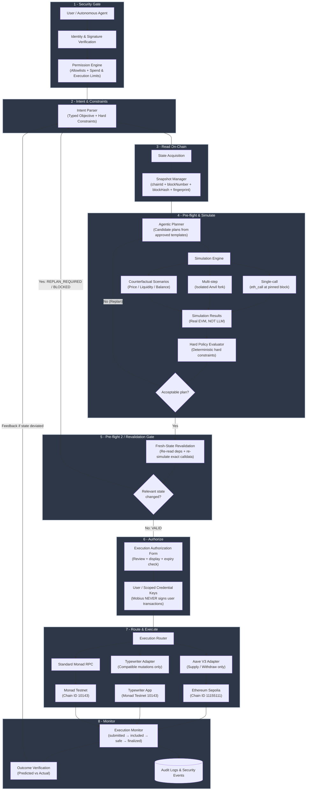

# Mobius — Agentic Transaction Intelligence

**Engineering build document · Architecture revision 2 · 4 November 2026**

Mobius is an agentic transaction-intelligence and execution-orchestration layer for leveraged DeFi positions. It receives a user or agent objective, obtains a versioned chain-state snapshot, creates typed candidate plans, simulates each candidate deterministically, evaluates results against hard policies, and revalidates the selected plan against fresh state immediately before execution.

This is a **one-day prototype playbook**, not a production launch plan. It is built for a three-person team, each working with a coding agent.

---

## What Mobius Is

Mobius is **not** just an `eth_call` wrapper, not a portfolio dashboard, and not an AI chatbot that executes trades. It is a decision-support engine where:

- **The AI agent** interprets intent, proposes typed candidate strategies, and explains trade-offs.
- **Deterministic code and the EVM simulation engine** decide whether a simulation passed, calculate trusted protocol state, and enforce financial safety.
- **The wallet** signs and submits. The backend never signs user transactions.

## Core Philosophy

| Responsibility | Who handles it |
|---|---|
| Interpreting user objective | AI agent (planner/explainer only) |
| Calculating Health Factor, liquidation distance, carry | Deterministic risk engine |
| Finding feasible repair actions | Optimization engine (mathematical, not LLM) |
| Explaining trade-offs and recommending actions | AI layer (supporting role) |
| Verifying recommendations against protocol constraints | Deterministic verification layer |
| Signing and broadcasting | User wallet |

**AI never invents Health Factors, guesses oracle prices, or independently decides whether a position is safe.** If a deterministic optimizer can find the best repair, AI is not needed for that part.

## Full System Architecture & Execution Flow



### The 8 Architectural Stages in Detail

1. **Stage 1 — Security Gate:**
   - Authenticates the calling user or autonomous agent.
   - Enforces deterministic permission policies: allowlisted chains, allowed action families, per-action and per-session spend limits.
2. **Stage 2 — Intent & Constraints:**
   - Converts natural-language or structured agent requests into typed objectives (`minAmountOut`, `maxSlippageBps`, `maxInputAmount`, `maxGasWei`, `minHealthFactor`).
   - Hard constraints can never be relaxed by an LLM.
3. **Stage 3 — Read On-Chain (State Acquisition):**
   - Snapshot Manager pins `chainId`, `blockNumber`, `blockHash`, timestamp, and computes a cryptographically verifiable **dependency fingerprint** (`rateWad`, oracle answer, reserve liquidity, user balance, allowance).
4. **Stage 4 — Pre-flight & Simulate:**
   - **Agentic Planner:** Generates typed candidate strategies from approved templates (e.g. `candidate_swap` vs `candidate_hold`).
   - **Simulation Engine:**
     - *Single-call:* `eth_call` at pinned block number via Viem.
     - *Multi-step:* Isolated local Anvil fork per candidate (state is preserved across multi-step transactions without cross-contaminating candidates).
     - *Counterfactual scenarios:* Stress tests across price/liquidity drifts.
   - **EVM Simulation Results:** Simulation output is derived strictly from the EVM execution, never fabricated by an LLM.
   - **Hard Policy Evaluator:** Filters out any candidate violating hard constraints. If no candidate passes, loops back to replan or returns `BLOCKED`.
5. **Stage 5 — Pre-flight 2 / Revalidation Gate:**
   - Immediately before presenting to the user for signature, Mobius re-reads critical dependencies from the latest block and re-computes the state fingerprint.
   - If relevant state has drifted or the call now reverts, returns `REPLAN_REQUIRED` or `BLOCKED`. It **never** silently lowers the user's minimum output or loosens constraints.
6. **Stage 6 — Authorize:**
   - Prepares an explicit execution authorization view for human review.
   - Scoped credential or user wallet signs. **Mobius backend NEVER holds custody or signs user transactions.**
7. **Stage 7 — Route & Execute:**
   - **Aave V3 Route (Sepolia `11155111`):** Dynamic pool resolution, 2-step approval gate, and supply/withdraw execution.
   - **Typewriter Route (Monad Testnet `10143`):** Submits signed application mutations to Typewriter sequencer (local EVM preconfirmation).
   - **Standard RPC Route (Monad Testnet `10143`):** Direct wallet submission for standard smart contracts.
8. **Stage 8 — Monitor:**
   - Tracks settlement lifecycle: `submitted` → `included` → `safe` → `finalized`.
   - **Outcome Verification:** Compares predicted state deltas against actual receipt events and logs feedback for future planning. Writes to immutable security audit logs.

### The Three Mobius Engines

| Engine | Responsibility | Must Not Do |
|---|---|---|
| Transaction intelligence | Decode tx, read state, simulate one call, classify failure, recommend correction | Guarantee future success from a snapshot |
| Agentic simulation | Turn objective into candidate plans, simulate alternatives, enforce constraints | Let an LLM fabricate success or bypass simulation |
| Execution orchestration | Revalidate, prepare wallet calls, route compatible mutations to Typewriter, monitor settlement | Treat Typewriter acceptance as chain finality |

## Chain Separation (Critical)

| Purpose | Network | Chain ID | RPC |
|---|---|---|---|
| Mobius demo + Typewriter POC | Monad Testnet | `10143` | `https://testnet-rpc.monad.xyz` |
| Aave V3 protocol test | Ethereum Sepolia | `11155111` | Your Sepolia RPC provider |
| Stateful multi-action simulation | Local Anvil fork | Fork of requested chain | `127.0.0.1` |

**Never** use the Sepolia Aave Pool address on Monad. Never label a Sepolia Aave transaction as a Monad transaction. Store `chainId` alongside every snapshot, plan, action, hash, contract address, and status.

## Repository Structure

```
mobius/
├── apps/
│   ├── api/                 # Fastify backend (Agent A / Lead)
│   │   ├── src/
│   │   │   ├── server.ts
│   │   │   ├── routes/      # health, chains, preflight, agentic, execution, aave
│   │   │   └── services/    # preflight-service, error-classifier, orchestration-service
│   │   └── package.json
│   └── typewriter-poc/      # Thin Typewriter adapter / isolated runner (Agent C)
├── contracts/
│   ├── foundry.toml
│   ├── src/
│   │   └── MockSwapTarget.sol        # Deterministic demo target (Agent B)
│   ├── test/
│   │   └── MockSwapTarget.t.sol
│   └── script/
│       └── DeployMockSwapTarget.s.sol
├── packages/
│   ├── chain-config/        # Viem chain clients, chain ID assertions (Agent A / Lead)
│   ├── contracts-abi/       # Shared TypeScript interfaces (all)
│   │   ├── src/preflight.ts
│   │   └── src/mock-swap.ts
│   ├── aave-adapter/        # Aave V3 Sepolia client (Agent C)
│   │   ├── src/addresses.ts
│   │   ├── src/abis.ts
│   │   └── src/aave-client.ts
│   ├── simulation/          # Simulation engine (Agent A / Lead)
│   └── policies/            # Deterministic policy evaluation (Agent A / Lead)
├── deployments/
│   ├── monad-testnet.json
│   └── sepolia-aave.json
├── docs/
│   ├── integration-notes.md
│   ├── demo-script.md
│   └── build-report.md
├── .env.example
├── .gitignore
├── PROJECT_MEMORY.md
└── README.md
```

## API Endpoints

| Endpoint | Method | Purpose |
|---|---|---|
| `GET /health` | GET | Process health and configured chain IDs |
| `GET /v1/chains` | GET | Supported chains and RPC availability |
| `POST /v1/preflight` | POST | Simulate one generic transaction against pinned snapshot |
| `POST /v1/agentic/plan` | POST | Typed objective → candidate plans → simulation → recommendation |
| `POST /v1/agentic/revalidate` | POST | Re-read dependencies, re-simulate, return VALID / REPLAN_REQUIRED / BLOCKED |
| `POST /v1/execution/prepare` | POST | Validated wallet transaction request (backend does NOT sign) |
| `GET /v1/execution/:id` | GET | Execution and settlement lifecycle status |
| `GET /v1/aave/sepolia/market` | GET | Resolve Aave Pool and asset metadata |
| `GET /v1/aave/sepolia/positions/:user` | GET | Aave user position summary |
| `POST /v1/aave/sepolia/supply/preflight` | POST | Check balance/allowance, simulate supply if ready |
| `POST /v1/aave/sepolia/withdraw/preflight` | POST | Simulate withdrawal from user position |

## Status Semantics

| Status | Meaning |
|---|---|
| `SIMULATION_PASSED` | Exact call succeeded against the stated snapshot only |
| `SIMULATION_REVERTED` | Exact call reverted against the stated snapshot |
| `PLAN_READY` | At least one candidate satisfies simulation and policy |
| `VALID` | Selected plan survived fresh-state revalidation; presentable for signature |
| `REPLAN_REQUIRED` | Relevant state changed; old plan must not be submitted |
| `BLOCKED` | No candidate allowed under user's hard constraints |
| `Typewriter accepted` | Typewriter locally ordered/executed mutation; NOT onchain inclusion |
| `included` / `safe` / `finalized` | Distinct onchain lifecycle stages |

## Key TypeScript Interfaces

All amounts, gas, and wei values are **decimal strings or bigint** — never JavaScript floating-point.

```typescript
export type PlanDecision = "EXECUTE" | "HOLD" | "HUMAN_REVIEW";
export type RevalidationStatus = "VALID" | "REPLAN_REQUIRED" | "BLOCKED";

export interface StateSnapshot {
  chainId: number;
  blockNumber: string;
  blockHash: `0x${string}`;
  observedAt: string;
  stateFingerprint: string;
  dependencies: Array<{ label: string; address?: `0x${string}`; valueHash: string }>;
}

export interface AgenticPlanRequest {
  chainId: number;
  account: `0x${string}`;
  objective: { type: string; description: string };
  constraints: {
    minAmountOut?: string;
    maxSlippageBps?: number;
    maxInputAmount?: string;
    maxGasWei?: string;
    minHealthFactor?: string;
    requireHumanApproval?: boolean;
  };
  context: { protocol: string; actionFamily: string; parameters: Record<string, string> };
}

export interface AgenticPlanResponse {
  planId: string;
  snapshot: StateSnapshot;
  candidates: CandidateResult[];
  selectedCandidateId?: string;
  decision: PlanDecision;
  decisionReason: string;
  caveat: string;
}
```

## MockSwapTarget (Monad Testnet Demo Contract — Teammate 1 Scope)

A deterministic simulation harness, **not a real DEX**. It does not exchange tokens or custody assets. Its sole purpose is to model a quote-dependent execution condition so Mobius can prove stale-quote detection and revalidation.

- **Contract:** `contracts/src/MockSwapTarget.sol`
  - `rateWad`: owner-updatable exchange rate (scaled to 1e18 WAD)
  - `quote(amountIn)`: view function returning simulated output `(amountIn * rateWad) / 1e18`
  - `swap(amountIn, minOut)`: executes simulated swap, reverts with `SlippageExceeded` if output < minOut
  - `totalSimulatedOutput`: tracks cumulative simulated output
  - Custom errors: `SlippageExceeded(actualOut, minOut)`, `InvalidAmount()`, `OnlyOwner()`, `InvalidRate()`
  - Events: `RateUpdated(oldRate, newRate)`, `SimulatedSwap(trader, amountIn, amountOut, minOut)`

### Testing & Validation Suite (`contracts/test/MockSwapTarget.t.sol`)
Comprehensive Foundry test suite covering:
1. **Initial State:** Deployer ownership, initial `rateWad = 1e18`, `totalSimulatedOutput = 0`.
2. **Quote Accuracy:** 1:1 at 1e18, 150:100 at 1.5e18, 50:100 at 0.5e18.
3. **Access Control:** `OnlyOwner` revert on unauthorized rate updates.
4. **Input Validation:** `InvalidRate` on 0 rate, `InvalidAmount` on 0 amount.
5. **Slippage Enforcement:** Exact revert `SlippageExceeded(actualOut, minOut)` when quote < minOut.
6. **Stale Quote Scenario (TOCTOU Proof):**
   - Trader reads quote at rate `1e18` (quote = 100).
   - Target rate changes onchain to `0.8e18`.
   - Trader submits transaction with planned `minOut = 100` -> Reverts with `SlippageExceeded(80, 100)`.
   - Replanning with refreshed quote `80` succeeds and updates `totalSimulatedOutput`.
7. **Fuzz Testing:** Property-based tests for arbitrary `amountIn`, `rateWad`, and `slippageBps`.

```bash
# Run tests
cd contracts
forge test -vvv
```

### Deployment & Verification (`contracts/script/DeployMockSwapTarget.s.sol`)
```bash
# 1. Set environment variables
export MONAD_RPC_URL="https://testnet-rpc.monad.xyz"

# 2. Deploy using Foundry script or forge create
forge script script/DeployMockSwapTarget.s.sol \
  --rpc-url "$MONAD_RPC_URL" \
  --account mobius-deployer \
  --broadcast

# 3. Verify on Monad Sourcify verifier
forge verify-contract \
  "$MOCK_SWAP_TARGET" \
  src/MockSwapTarget.sol:MockSwapTarget \
  --chain 10143 \
  --verifier sourcify \
  --verifier-url https://sourcify-api-monad.blockvision.org

# 4. Deployment record saved in deployments/monad-testnet.json
```

## Aave V3 Sepolia Integration

- Pool resolved dynamically from `PoolAddressesProvider.getPool()`
- Test assets via Aave faucet on Sepolia test market
- Supply flow: read balance/allowance → if insufficient, return `NOT_READY` + `approvalRequired=true` → user signs approval → re-run preflight → user signs supply → verify receipt and position
- **Never** hardcode Pool address; resolve at runtime
- **Never** route Aave calls through Typewriter on day one

## Typewriter Integration

- Optional execution adapter for compatible Monad application mutations
- Local-first: run upstream `apps/token` example with PostgreSQL + local Anvil
- Testnet POC: deploy only after core path is complete
- Typewriter sits **after** Mobius planning, simulation, policy, and revalidation
- Does **not** replace Mobius and does **not** make arbitrary DeFi calls Typewriter-compatible

## Team & Workflow

Three-person team, three branches, no overlapping file ownership:

| Owner | Responsibility | Coding Agent | Allowed Files |
|---|---|---|---|
| You — Lead / Developer 1 | Architecture, API, snapshot manager, planner, orchestrator, policy, merges | Agent A | `apps/api/**`, `packages/chain-config/**`, `packages/contracts-abi/**`, `packages/simulation/**`, `packages/policies/**` |
| Teammate 1 | Solidity / Monad | Agent B | `contracts/**`, `deployments/monad-testnet.json` |
| Teammate 2 | DeFi / Typewriter | Agent C | `packages/aave-adapter/**`, `apps/typewriter-poc/**`, `docs/integration-notes.md` |

**Merge rules:** Human owner reads every diff, runs assigned tests, confirms no secrets or `node_modules` committed, confirms chain IDs and addresses are explicit, confirms no invented deployment addresses.

## One-Day Definition of Done

1. Deploy `MockSwapTarget` to Monad Testnet; verify address and code
2. Submit stale tx to `POST /v1/preflight`; Mobius decodes revert and recommends safe step without broadcasting
3. Submit objective to `POST /v1/agentic/plan`; returns ≥2 typed candidates (execute or hold/defer), simulation results, reasoned recommendation
4. Change target onchain state after planning; `POST /v1/agentic/revalidate` detects drift and returns `REPLAN_REQUIRED` or `BLOCKED`
5. Demonstrate one Aave V3 Sepolia supply flow (or verified market reads + real supply simulation)
6. Run official Typewriter token example locally; capture mutation lifecycle
7. Deploy Typewriter to Monad Testnet only if core path is complete
8. Chain ID, block snapshot, status semantics, and execution route explicit in every response

## Explicit Non-Goals

- No mainnet deployment, real funds, production-readiness claims, or key custody
- No full Aave protocol deployment onto Monad
- No custom Aave lending market or fake Aave contract
- No claim that an LLM-generated plan is a simulation result
- No claim that a passing snapshot simulation guarantees future inclusion or success
- No automatic relaxation of user slippage, minimum output, debt, collateral, or spending constraints
- No autonomous transfer of funds without explicit user-authorized limits and signature

## 🚀 How to Set Up in Your Device

Follow these steps to get Mobius running locally on your machine:

### 1. Prerequisites
Ensure you have the following installed:
- [Node.js](https://nodejs.org/) (`v20.x` or `v22.x LTS` recommended)
- [Git](https://git-scm.com/)
- [npm](https://www.npmjs.com/) (bundled with Node.js) or [bun](https://bun.sh/)
- *(Optional for smart contract workflows)*: [Foundry](https://book.getfoundry.sh/getting-started/installation) (`forge`, `cast`, `anvil`)

### 2. Clone the Repository
Clone the repository to your local workspace:
```bash
git clone https://github.com/Sayandeep-the-coder/Mobius.git
cd Mobius
```

### 3. Install Dependencies
Install all required project packages:
```bash
npm install
```

### 4. Configure Environment (Optional)
If connecting to custom RPC endpoints or Monad Testnet, you can create a `.env.local` file:
```env
NEXT_PUBLIC_MONAD_RPC_URL=https://testnet-rpc.monad.xyz
NEXT_PUBLIC_CHAIN_ID=10143
```

### 5. Start the Development Server
Launch the Next.js local server with Turbopack:
```bash
npm run dev
```

Open [http://localhost:3000](http://localhost:3000) in your browser to view the interactive Mobius risk rehearsal platform.

### 6. Build for Production
To generate and run an optimized production build:
```bash
npm run build
npm run start
```

### 7. Code Quality & Type Check
Verify type safety and linting:
```bash
npm run lint
```

## Toolchain

- Node.js 22 LTS+
- Bun (Typewriter monorepo uses Bun workspaces)
- Foundry (forge, cast, anvil) with Monad support
- TypeScript, Fastify, Viem, Zod
- Docker Desktop (optional; PostgreSQL for Typewriter)
- Rabby or MetaMask wallet

## Demo Script (6–8 minutes)

1. **Demo 1 — Agentic simulation detects stale state (Monad):** Plan a `swap` with explicit `minOut`; change `rateWad` onchain; revalidate; show `REPLAN_REQUIRED` / `BLOCKED`; prove Mobius does not auto-lower `minOut` or broadcast stale call.
2. **Demo 2 — Typewriter mutation lifecycle (local → Monad Testnet):** Show accepted → included → safe/finalized; distinguish accepted from onchain finality.
3. **Demo 3 — Aave V3 Sepolia supply:** Resolve Pool dynamically; show balance/allowance; user signs approval; re-simulate; user signs supply; verify receipt and position.

---

> **Note:** This README reflects the one-day build playbook (architecture revision 2, 4 November 2026). For detailed interface definitions, exact addresses, chain configurations, error classification rules, and the full team brief, see `PROJECT_MEMORY.md`.