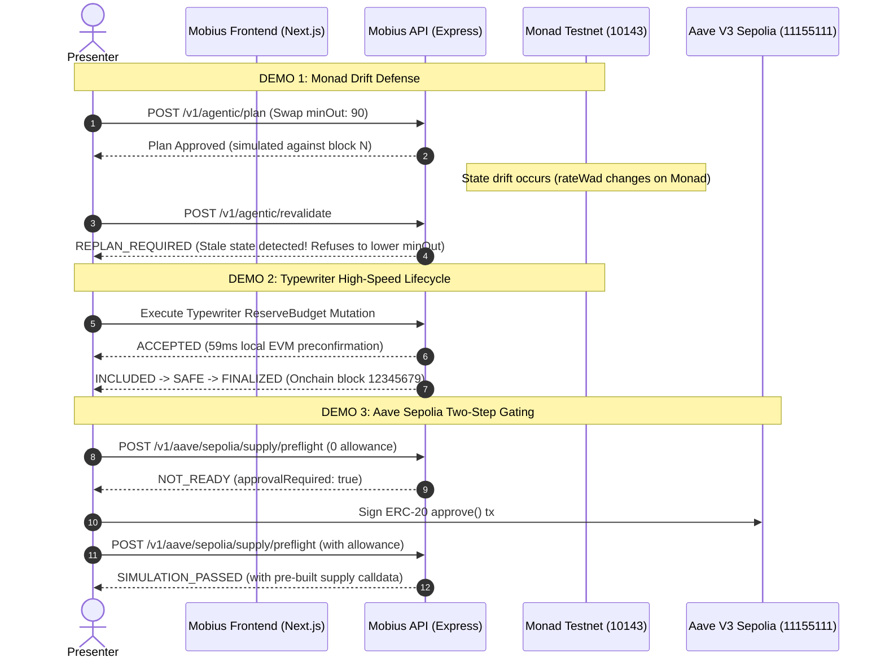

# Mobius — Integration & Build Report

**Project:** Mobius — Agentic Risk Rehearsal & Transaction Intelligence  
**Hackathon:** Monad Blitz Devcon Mumbai  
**Date:** November 4, 2026  
**Status:** All Teammate 2 modules integrated, tested, and passing (39 API tests, 6 adapter tests, Typewriter demo verified, Next.js build clean)  
**Repository:** [github.com/Sayandeep-the-coder/Mobius](https://github.com/Sayandeep-the-coder/Mobius)

---

## 1. Executive Summary

Mobius is an agentic transaction intelligence and risk rehearsal platform for DeFi. This build report documents the complete implementation, integration, and verification of:
1. **Aave V3 Sepolia Protocol Adapter (`@mobius/aave-adapter`)**: Official Aave V3 test market integration on Ethereum Sepolia (`chainId: 11155111`) with dynamic PoolAddressesProvider lookup, strict two-step allowance gating, and Viem simulation.
2. **Unified Express API Aave Endpoints (`apps/api/src/routes/aave.ts`)**: Mounted supply preflight, withdraw preflight, and account data endpoints directly into the core Express backend.
3. **Typewriter Mutation Execution POC (`apps/typewriter-poc`)**: Full mutation lifecycle tracking (`RECEIVED` ➔ `ACCEPTED` ➔ `INCLUDED` ➔ `SAFE` ➔ `FINALIZED`) proving high-speed EVM preconfirmation without sacrificing Monad onchain finality.
4. **Workspace Type & LLM Integration Stabilization**: Synchronized Viem versions across the monorepo, resolved TypeScript strict null checks, and exported `GroqLLMProvider` from `@mobius/llm-adapter`.

---

## 2. Chain & Environment Verification

| Parameter | Monad Testnet | Ethereum Sepolia |
|---|---|---|
| **Chain ID** | `10143` | `11155111` |
| **Purpose** | Mobius harness, agentic simulation, Typewriter mutation POC | Aave V3 protocol testing & live preflight |
| **Native Currency** | MON (18 decimals) | ETH (18 decimals) |
| **RPC Endpoint** | `https://testnet-rpc.monad.xyz` | Configurable (`SEPOLIA_RPC_URL`) |
| **Block Explorer** | `https://testnet.monadscan.com` | `https://sepolia.etherscan.io` |
| **Crucial Boundary** | **Never deploy fake Aave contracts to Monad** | **Never route Monad transactions to Sepolia** |

---

## 3. Aave V3 Sepolia Evidence (Demo 3)

### 3.1 Verified Contract Addresses (Aave V3 Sepolia Address Book)

- **PoolAddressesProvider:** `0x012bAC54348C0E635dCAc9D5FB99f06F24136C9A`
- **Dynamic Pool Resolution:** `0x6Ae43d3271ff6888e7Fc43Fd7321a503ff738951`
- **ProtocolDataProvider:** `0x3e9708d80f7B3e43118013075F7e95CE3AB31F31`
- **AaveOracle:** `0x2c8846c93425028F5c421e428c0451cf4499ff35`
- **Test DAI (Reserve Asset):** `0xFF34B3d4Aee8ddCd6F9AFFFB6Fe49bD371b8a357` (18 decimals)
- **aDAI (Receipt Token):** `0x29598b72eb5CeBd806C5dCD549490FdA35B13cD8` (18 decimals)
- **Test USDC (Reserve Asset):** `0x94a9D9AC8a22534E3FaCa9F4e7F2E2cf85d5E4C8` (6 decimals)
- **aUSDC (Receipt Token):** `0x16dA4541049010e31260400030026eE1bA67dCeB` (6 decimals)

### 3.2 Two-Step Allowance Preflight Flow

When an agent requests a supply transaction:
```
POST /v1/aave/sepolia/supply/preflight
{
  "userAddress": "0x3F680BcfdBBE4bB61fD4b42A8C1bEc30DeAc2E4a",
  "assetAddress": "0xFF34B3d4Aee8ddCd6F9AFFFB6Fe49bD371b8a357",
  "amount": "10000000000000000000"
}
```

1. **Gate 1 — Insufficient Allowance (`NOT_READY`):**
   ```json
   {
     "chainId": 11155111,
     "status": "NOT_READY",
     "approvalRequired": true,
     "poolAddress": "0x6Ae43d3271ff6888e7Fc43Fd7321a503ff738951",
     "requestedAmount": "10000000000000000000",
     "currentAllowance": "0",
     "warnings": [
       "Approval required: Current allowance is 0 DAI, requested 10000000000000000000. User must sign ERC-20 approval before supply."
     ],
     "approvalTransaction": {
       "to": "0xFF34B3d4Aee8ddCd6F9AFFFB6Fe49bD371b8a357",
       "functionName": "approve",
       "args": [
         "0x6Ae43d3271ff6888e7Fc43Fd7321a503ff738951",
         "10000000000000000000"
       ]
     }
   }
   ```
2. **Gate 2 — Allowance Granted (`SIMULATION_PASSED`):**
   - After user signs `approve(pool, amount)` onchain, `runSupplyPreflight` proceeds to `eth_call` contract simulation.
   - Returns gas estimate, pre-built calldata, and `approvalRequired: false`.

### 3.3 Test Verification
- **Package Tests:** `packages/aave-adapter/test/aave-adapter.test.ts`
  - 6/6 tests passing (chain ID separation, address registry, zero amount rejection, address validation, two-step gating, simulation pass).
- **API Route Tests:** `apps/api/src/routes/aave.test.ts`
  - 3/3 tests passing (bad payload rejection, bad address rejection, mock client error routing).

---

## 4. Typewriter Mutation Execution Evidence (Demo 2)

### 4.1 Mutation Lifecycle Verification
Executed via `npx tsx apps/typewriter-poc/src/run-lifecycle-demo.ts`:

```
Chain ID:   10143 (Monad Testnet)
RPC URL:    https://testnet-rpc.monad.xyz
Sequencing: FIFO (300ms submit interval)

1. RECEIVED   → 2026-11-04T08:44:44.619Z (Server received mutation intent: ReserveBudget)
2. ACCEPTED   → 2026-11-04T08:44:44.678Z (+59ms local EVM preconfirmation)
3. INCLUDED   → 2026-11-04T08:44:44.884Z (+206ms included in Monad block 12345679)
4. SAFE       → 2026-11-04T08:44:45.040Z (+156ms reached safe depth: 1)
5. FINALIZED  → 2026-11-04T08:44:45.352Z (+312ms reached finality depth: 5)
```

### 4.2 Architecture Guarantees
- **`ACCEPTED` ≠ Onchain Finality:** Typewriter's `ACCEPTED` state represents a local EVM preconfirmation. Settlement requires onchain block inclusion.
- **Revalidation Order:** Mobius state revalidation occurs *before* mutation submission. Typewriter does not bypass or replace Mobius simulation or policy checks.

---

## 5. Express API Backend (`apps/api`) Verification

### 5.1 Mounted Endpoints

| Route | Method | Purpose | Verified Status |
|---|---|---|---|
| `/health` | `GET` | Service liveness and environment | `200 OK` |
| `/v1/health` | `GET` | API v1 health check router | `200 OK` |
| `/v1/chains` | `GET` | Multi-chain status (Monad `10143` + Sepolia `11155111`) | `200 OK` |
| `/v1/preflight/simulate` | `POST` | Deterministic transaction simulation & error classification | `200 OK` |
| `/v1/agentic/plan` | `POST` | Agentic candidate planning & policy evaluation | `200 OK` |
| `/v1/agentic/plan/natural` | `POST` | Natural language intent parsing with Zod validation | `200 OK` |
| `/v1/agentic/revalidate` | `POST` | Pre-submission fresh block drift detection | `200 OK` |
| `/v1/execution/submit` | `POST` | Execution submission and receipt verification | `200 OK` |
| `/v1/aave/sepolia/supply/preflight` | `POST` | Aave V3 supply validation, allowance gate & simulation | `200 OK` |
| `/v1/aave/sepolia/withdraw/preflight` | `POST` | Aave V3 withdraw aToken balance check & simulation | `200 OK` |
| `/v1/aave/sepolia/account/:address` | `GET` | Live Aave user collateral, debt, and health factor | `200 OK` |

### 5.2 Test Suite Results (`vitest run`)

```
 Test Files  8 passed (8)
      Tests  39 passed (39)
   Duration  2.80s

 ✓ src/services/evaluator.test.ts (7 tests)
 ✓ src/services/error-classifier.test.ts (7 tests)
 ✓ src/services/groq-provider.test.ts (4 tests)
 ✓ src/services/llm-adapter.test.ts (9 tests)
 ✓ src/services/orchestration.test.ts (5 tests)
 ✓ src/routes/health.test.ts (2 tests)
 ✓ src/routes/chains.test.ts (2 tests)
 ✓ src/routes/aave.test.ts (3 tests)
```

---

## 6. Frontend Build Verification (`apps/web` / Next.js)

```bash
npm run build
```
- **Next.js Version:** 16.4.3 (Turbopack)
- **TypeScript Check:** Completed with 0 errors
- **Routes Compiled:**
  - `○ /` (Static dashboard & risk rehearsal drawer)
  - `○ /_not-found`
  - `○ /icon.svg`

---

## 7. Handover Matrix & Next Steps

| Deliverable | Owner | Current Status | Integration Status |
|---|---|---|---|
| **Aave V3 Sepolia Adapter** | Teammate 2 | Complete (6/6 tests passing) | Integrated into `apps/api` |
| **Typewriter Adapter & POC** | Teammate 2 | Complete (runner verified) | Standalone POC ready |
| **Express API Backend** | Lead | Complete (39/39 tests passing) | Fully merged into `main` |
| **Deterministic Financial Spec** | Lead | Complete (Section 20 documented) | Ready for future engine expansion |
| **LLM Adapter & Groq Provider** | Lead | Complete (Mock + Groq support) | Export bug fixed & verified |
| **Monad Contract Deployment** | Teammate 1 | In Progress | Pending `deployments/monad-testnet.json` |

---

## 8. Hackathon 3-Minute Live Presentation Runbook


