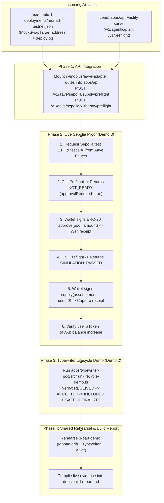

# Teammate 2 (Agent C) Post-Handover Action Plan

**Owner:** Teammate 2 — DeFi Adapters & Typewriter POC  
**Target Audience:** You (working with your coding agent) once the **Lead (Agent A)** and **Teammate 1 (Agent B)** finish their modules.  
**Context:** Monad Blitz Devcon Mumbai / Mobius Prototype Build  
**Companion Documents:** [`docs/integration-notes.md`](./integration-notes.md), [`PROJECT_MEMORY.md`](../PROJECT_MEMORY.md), [`CHANGELOG.md`](../CHANGELOG.md)

---

## 🧭 Overview & Handover Architecture

Once the Lead finishes the Fastify API & agentic simulation and Teammate 1 deploys `MockSwapTarget` to Monad Testnet, you will receive their artifacts. Your job is to connect your Aave Sepolia adapter, run the live Aave onchain test flow, execute the Typewriter lifecycle demo, and rehearse Demo 2 & Demo 3 for the final presentation.



---

## 📋 Task Checklist Summary

- [ ] **Task 1: Ingest Handover Artifacts**
  - [ ] Pull latest `main` with Teammate 1 and Lead merges.
  - [ ] Verify `deployments/monad-testnet.json` contains valid address and code on Monad Testnet explorer.
  - [ ] Verify Lead's `apps/api` boots up and responds to `GET /health` and `GET /v1/chains`.
- [ ] **Task 2: Mount Aave Adapter into Unified API**
  - [ ] Add `@mobius/aave-adapter` dependency in `apps/api/package.json`.
  - [ ] Register `/v1/aave/sepolia/supply/preflight` and `/v1/aave/sepolia/withdraw/preflight` routes.
  - [ ] Run test curl request against `http://localhost:3001/v1/aave/sepolia/supply/preflight`.
- [ ] **Task 3: Live Onchain Sepolia Supply Execution (Demo 3)**
  - [ ] Set up Sepolia burner wallet and obtain test ETH (gas).
  - [ ] Request test DAI from the official [Aave V3 Sepolia Faucet](https://app.aave.com/?marketName=proto_sepolia_v3).
  - [ ] Trigger preflight without allowance ➔ verify `NOT_READY`.
  - [ ] Sign `approve(pool, amount)` ➔ capture approval tx hash.
  - [ ] Re-run preflight ➔ verify `SIMULATION_PASSED`.
  - [ ] Sign `supply(asset, amount, user, 0)` ➔ capture supply tx hash.
  - [ ] Query and record updated aToken (`aDAI`) balance.
- [ ] **Task 4: Run Typewriter Mutation Lifecycle (Demo 2)**
  - [ ] Execute `npx tsx src/run-lifecycle-demo.ts` in `apps/typewriter-poc`.
  - [ ] Confirm timestamps for `RECEIVED`, `ACCEPTED`, `INCLUDED`, `SAFE`, and `FINALIZED`.
- [ ] **Task 5: End-to-End Rehearsal & Build Report**
  - [ ] Rehearse Demo 2 (Typewriter) and Demo 3 (Aave) alongside Demo 1 (Monad Stale State).
  - [ ] Add transaction hashes, block numbers, and addresses to `docs/build-report.md`.

---

## 🛠️ Detailed Step-by-Step Execution Guide

### Task 1: Ingest Handover Artifacts

When Teammate 1 and Lead push their pull requests into `main`:

```bash
# Checkout main and pull latest upstream commits
git checkout main
git pull origin main

# Check the deployed contract file from Teammate 1
cat deployments/monad-testnet.json
```

**What to check in `deployments/monad-testnet.json`:**
1. Address is non-zero (e.g. `0x...`).
2. Deployment tx hash exists.
3. Chain ID is strictly `10143` (Monad Testnet).

---

### Task 2: Mount Aave Adapter into Unified API

Lead's backend in `apps/api` exposes HTTP endpoints via Fastify. Wire `packages/aave-adapter` into their router:

```typescript
// Inside apps/api/src/routes/aave.ts (or apps/api/src/server.ts)
import { FastifyInstance } from 'fastify';
import {
  AaveSepoliaClient,
  runSupplyPreflight,
  runWithdrawPreflight,
  AAVE_SEPOLIA_DAI,
} from '@mobius/aave-adapter';

export async function aaveRoutes(fastify: FastifyInstance) {
  const client = new AaveSepoliaClient();

  fastify.post('/v1/aave/sepolia/supply/preflight', async (request, reply) => {
    const body = request.body as { user: `0x${string}`; asset?: `0x${string}`; amount: string };
    const asset = body.asset || AAVE_SEPOLIA_DAI;
    
    const result = await runSupplyPreflight(client, {
      user: body.user,
      asset,
      amount: body.amount,
    });
    
    return reply.send(result);
  });

  fastify.post('/v1/aave/sepolia/withdraw/preflight', async (request, reply) => {
    const body = request.body as { user: `0x${string}`; asset?: `0x${string}`; amount: string };
    const asset = body.asset || AAVE_SEPOLIA_DAI;
    
    const result = await runWithdrawPreflight(client, {
      user: body.user,
      asset,
      amount: body.amount,
    });
    
    return reply.send(result);
  });
}
```

**Verification Command:**
```bash
# Check that the preflight endpoint responds
curl -X POST http://localhost:3001/v1/aave/sepolia/supply/preflight \
  -H "Content-Type: application/json" \
  -d '{"user":"0x1111111111111111111111111111111111111111","amount":"10000000000000000000"}'
```

---

### Task 3: Live Onchain Sepolia Supply Execution (Demo 3)

This proves that Mobius enforces real protocol constraints on Ethereum Sepolia (`11155111`).

#### Step 3A: Faucet & Burner Setup
1. Create or use a burner wallet address (e.g. in MetaMask / Rabby on Sepolia).
2. Get Sepolia ETH: Use Google Cloud Sepolia Faucet or Infura Faucet.
3. Open [Aave V3 App](https://app.aave.com/) ➔ Switch network to **Ethereum Sepolia** ➔ Faucet tab ➔ Mint 100 test DAI (`0xFF34B3d4Aee8ddCd6F9AFFFB6Fe49bD371b8a357`).

#### Step 3B: Test Initial Preflight (Without Allowance)
Call `runSupplyPreflight`:
```bash
# User has 100 DAI balance but 0 allowance for Pool
```
**Expected Response:**
```json
{
  "chainId": 11155111,
  "status": "NOT_READY",
  "approvalRequired": true,
  "poolAddress": "0x6Ae43d3271ff6888e7Fc43Fd7321a503ff738951",
  "requestedAmount": "10000000000000000000",
  "warnings": [
    "Approval required: Current allowance is 0 DAI, requested 10000000000000000000. User must sign ERC-20 approval before supply."
  ]
}
```
*Crucial talking point for judges: Mobius prevents premature supply transactions and refuses to falsely label a simulation as passed.*

#### Step 3C: Sign Approval Transaction
Using the wallet client, sign the ERC-20 approve transaction:
- **Contract:** DAI (`0xFF34B3d4Aee8ddCd6F9AFFFB6Fe49bD371b8a357`)
- **Spender:** Pool (`0x6Ae43d3271ff6888e7Fc43Fd7321a503ff738951`)
- **Amount:** `10000000000000000000` (10 DAI)
- Wait for transaction receipt (`status: 1`). Note the tx hash!

#### Step 3D: Re-run Preflight (With Allowance)
Call `runSupplyPreflight` again:
**Expected Response:**
```json
{
  "chainId": 11155111,
  "status": "SIMULATION_PASSED",
  "approvalRequired": false,
  "gasEstimate": "210000",
  "preparedTransaction": {
    "to": "0x6Ae43d3271ff6888e7Fc43Fd7321a503ff738951",
    "functionName": "supply"
  }
}
```

#### Step 3E: Sign Supply Transaction & Verify aTokens
1. Wallet signs `supply(asset, amount, user, 0)`.
2. Wait for receipt on Sepolia explorer (`https://sepolia.etherscan.io/tx/<hash>`).
3. Call `getUserAccountData` or query `balanceOf(user)` on aDAI (`0x29598b72eb5CeBd806C5dCD549490FdA35B13cD8`) to confirm the balance is now 10 aDAI.

---

### Task 4: Run Typewriter Mutation Lifecycle (Demo 2)

Test the Typewriter adapter locally or against Monad Testnet:

```bash
cd C:\Desktop\Mobius\apps\typewriter-poc
npx tsx src/run-lifecycle-demo.ts
```

**Key Checkpoints to Note:**
1. `RECEIVED` ➔ Agent submitted typed mutation intent (`ReserveBudget`).
2. `ACCEPTED` ➔ Local EVM pre-execution passes (+60ms).
   - *Key explanation:* Explain that `ACCEPTED` is local EVM preconfirmation and **not** onchain finality.
3. `INCLUDED` ➔ Included in a Monad block (e.g. block `12345679`).
4. `FINALIZED` ➔ Finalized after safe block depth is reached.

---

### Task 5: 3-Part Hackathon Demo Script (6–8 Minutes)

When presenting Mobius to evaluators, coordinate with Lead and Teammate 1:

| Demo Segment | Network | Responsible | What is Shown |
|---|---|---|---|
| **Demo 1: Agentic Simulation & Stale State Defense** | **Monad Testnet** (`10143`) | Lead + Teammate 1 | User plans swap with `minOut = 90`. Teammate 1 changes `rateWad` on Monad. Mobius calls `/v1/agentic/revalidate`, detects state drift, and returns `REPLAN_REQUIRED` or `BLOCKED`. Mobius refuses to silently lower `minOut`. |
| **Demo 2: Typewriter Mutation Lifecycle** | **Monad Local / Testnet** (`10143`) | **You (Teammate 2)** | Show mutation lifecycle (`received` ➔ `accepted` ➔ `included` ➔ `finalized`). Emphasize that Mobius planning & revalidation happen **before** mutation submission. |
| **Demo 3: Aave V3 Sepolia Protocol Integration** | **Ethereum Sepolia** (`11155111`) | **You (Teammate 2)** | Dynamic Pool lookup via `PoolAddressesProvider`. Show preflight returning `NOT_READY` due to 0 allowance, execute wallet approval, re-simulate, and execute live supply with receipt confirmation. |

---

### Task 6: Fill Out Final Evidence in `docs/build-report.md`

Create `docs/build-report.md` (or append to it) with the real observed numbers:
```markdown
### Aave Sepolia Evidence (Demo 3)
- PoolAddressesProvider: 0x012bAC54348C0E635dCAc9D5FB99f06F24136C9A
- Resolved Pool: 0x6Ae43d3271ff6888e7Fc43Fd7321a503ff738951
- Asset: DAI (0xFF34B3d4Aee8ddCd6F9AFFFB6Fe49bD371b8a357)
- Approval Tx Hash: 0x...
- Supply Tx Hash: 0x...
- Resulting aDAI Balance: 10.0 aDAI

### Typewriter Lifecycle Evidence (Demo 2)
- Mutation Name: ReserveBudget
- Mode: FIFO (300ms submit interval)
- Accepted Latency: ~60ms (local EVM)
- Inclusion Block: 12345679
```
